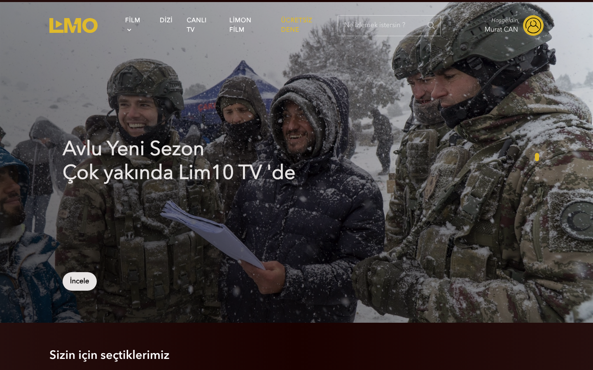
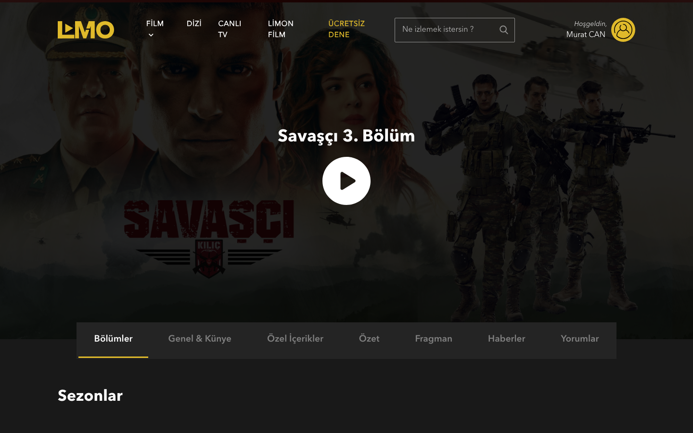
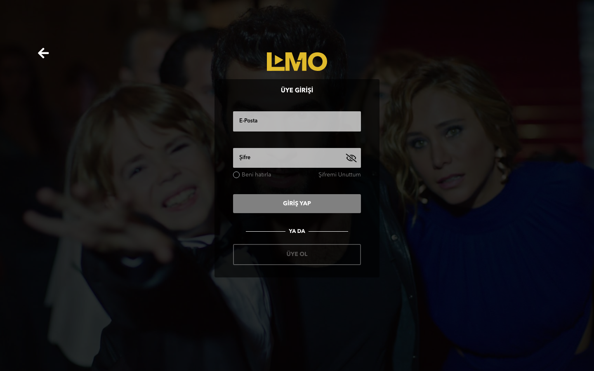
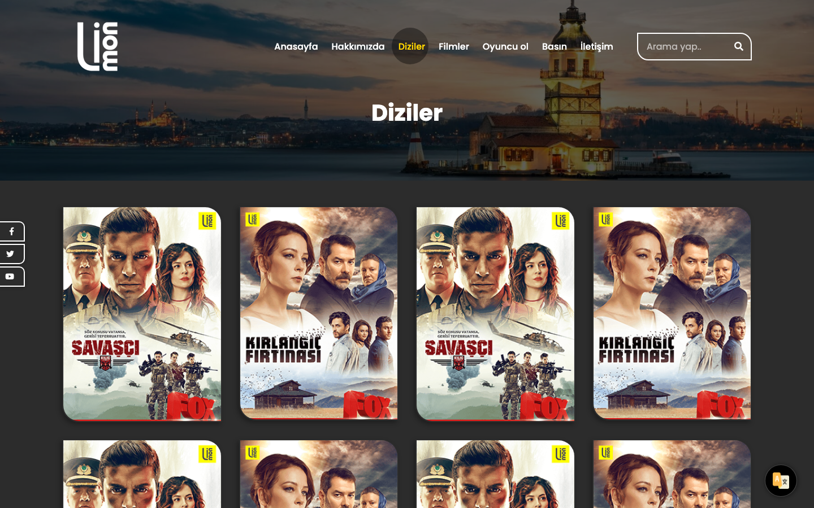
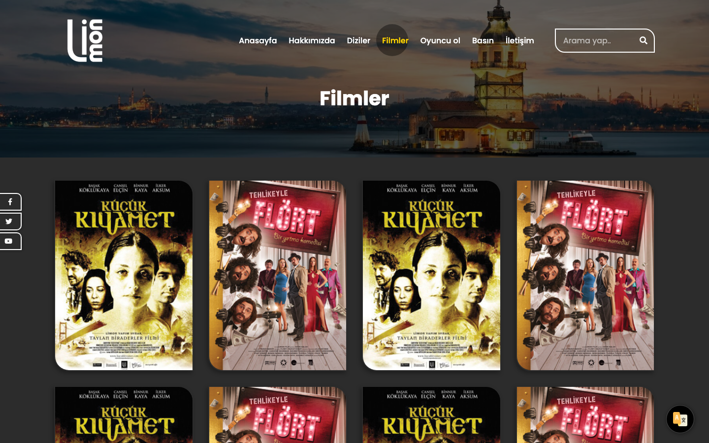
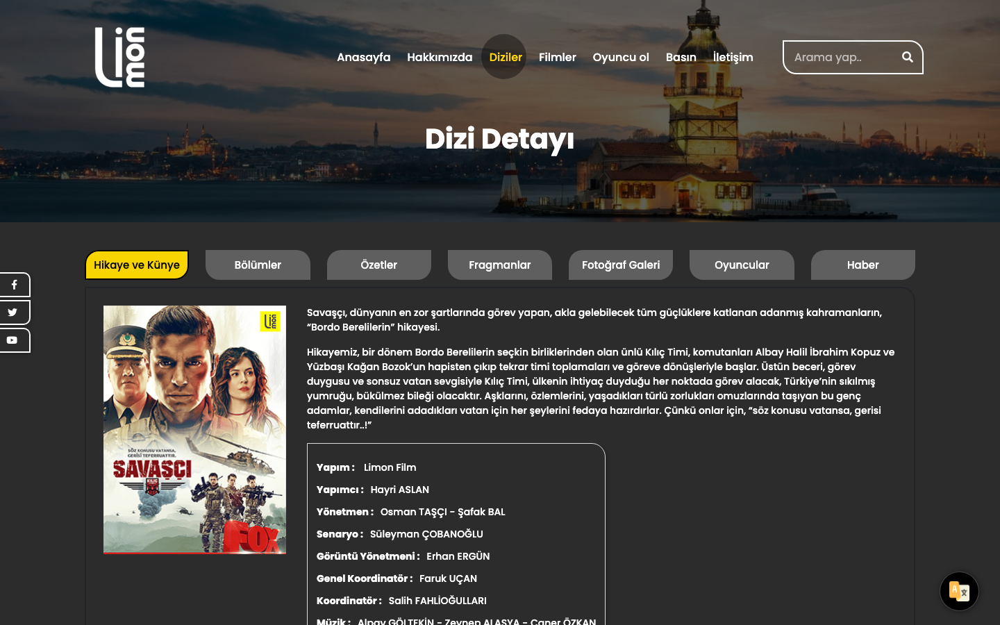
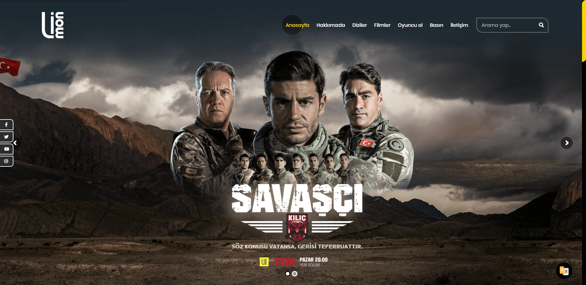

# Lim10 TV & Limon Production — Streaming Platform UI

**Front end of Lim10 TV, the internet television platform of the production company Limon Film, together with the company's own website**: streaming home and series pages, a customised video player with hover previews, and the Laravel views and admin of the production site.




| | |
|---|---|
| **Role** | Senior front-end engineer at Limon Film Production |
| **Period** | 2017 – 2018 |
| **Projects** | Lim10 TV (streaming UI) · limonproduction.com (Laravel site + admin) · clickia (Laravel views) |
| **Stack** | HTML · CSS · jQuery · Vue 2 · Plyr (customised) · Owl Carousel · Flickity · Laravel Blade |

## Lim10 TV · [`lim10-tv/`](lim10-tv)

- **Hover previews in content rails.** Hovering a title in a carousel waits 700 ms, then plays a muted preview in place with its own progress bar, and stops on mouse-out. The first and last visible cards get edge classes so they can scale without clipping.
- **Customised Plyr player.** A full-screen watch page with an overlaid play control, multiple source qualities, poster on end and an idle cursor that hides while the video plays. The Plyr build in `players/` is adapted for the platform; `devjs/` holds the development copy.
- **Series detail.** Hero with the next episode, and tabs for episodes, cast and credits, exclusive content, synopsis, trailers, news and comments, plus season switching.
- **Account screens.** Sign-in, password reset and a free-trial entry point in the header.

| | |
|---|---|
|  **Series detail** with episode tabs |  **Sign-in** |

## Limon Production website · [`limon-website/`](limon-website)

- `templates/`: static site for the production company: series and films catalogues, title detail with tabs (story, episodes, cast, production credits, photos, news), press and contact.
- `laravel/`: the same site as Laravel Blade views, plus the **admin views**: pages, sliders, projects and project types, translations, settings, activity logs, users, **roles and permissions** with an unauthorised screen.

| | |
|---|---|
|  **Series catalogue** |  **Films** |
|  **Title detail** |  **Home** (original screenshot) |

## clickia · [`clickia/`](clickia)

Blade views for clickia: home, productions, distribution, games, jobs, news and contact on three layout variants.

## Running the static parts

```bash
php -d short_open_tag=On -S localhost:8096 -t lim10-tv
php -d short_open_tag=On -S localhost:8097 -t limon-website/templates
```

The Laravel application code (routes, controllers, models) was not preserved; the Blade views are kept as source. Videos, the commercial Revolution Slider, the Limitless admin theme and the Social Stream plugin are not included.

## What I would do differently today

- Build the rails and the player as **components** (Vue 3 or React) with a typed media layer instead of jQuery hover handlers.
- Stream with **HLS/DASH and adaptive bitrate** rather than progressive MP4 sources.
- Respect **reduced-motion** and data-saver settings before autoplaying hover previews.

---

<sub>Built at Limon Film Production. Series artwork belongs to its owners. Credentials have been removed; videos and commercial plugins are not included. Shared for portfolio purposes; no license is granted for reuse.</sub>
